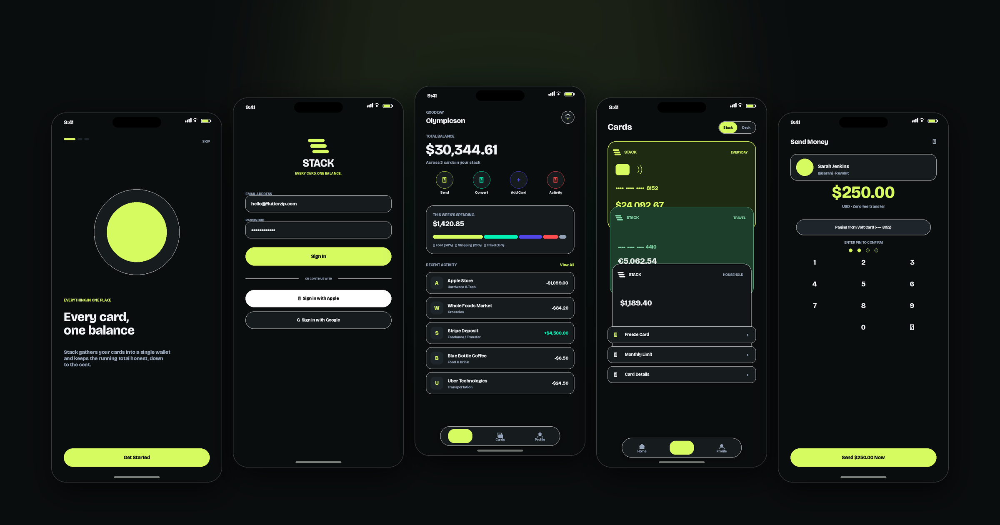
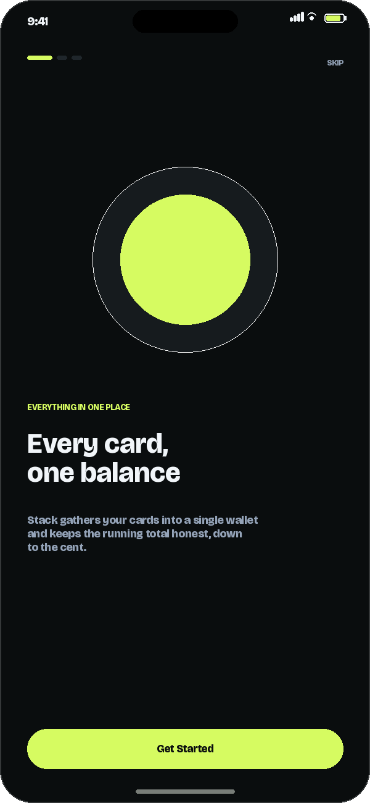
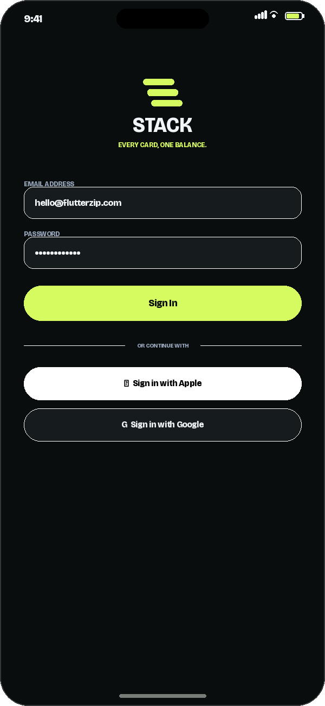
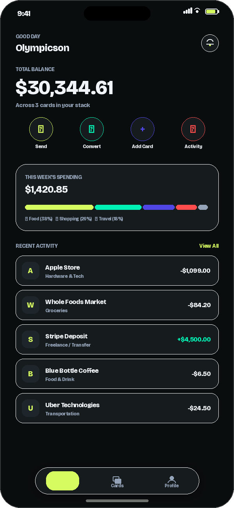
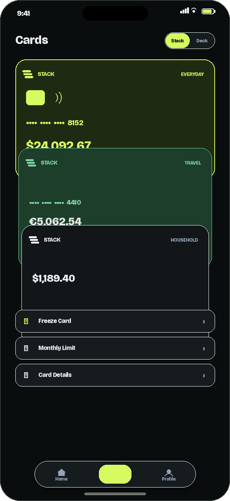
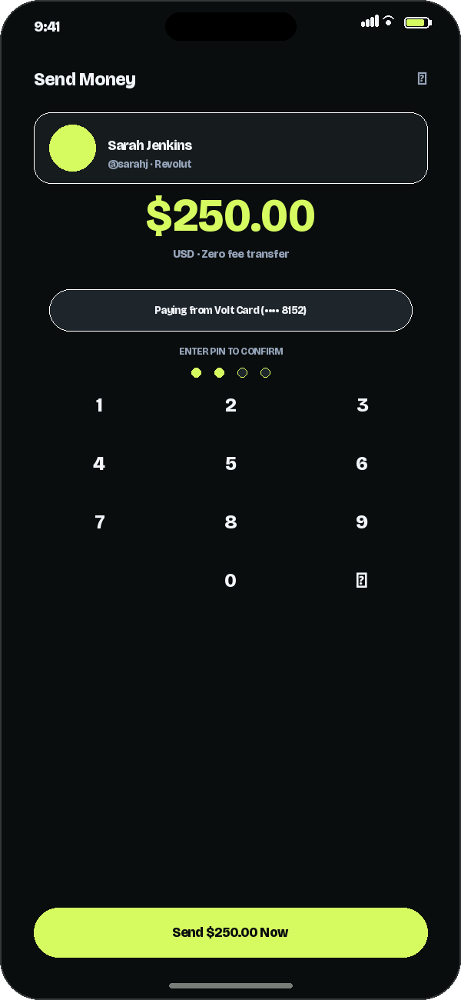
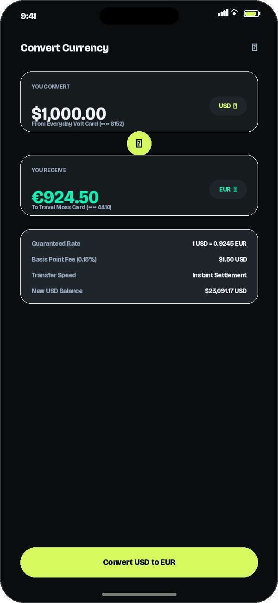

<div align="center">


# Stack: React Native Wallet & Fintech App

> **Every card, one balance.**

A premium **React Native + Expo** card wallet and payments app built with **NativeWind v4** (Tailwind CSS), **Phosphor Icons**, and **Reanimated v3**.

<br />



</div>

<br />

## Highlights

- **Vibrant Modern Fintech Aesthetic**: Obsidian dark canvas (`#0A0D0E`) with high-energy Neon Acid Lime accents (`#D6FB61`), designed for maximum contrast and readability.
- **Dual Card Deck View**:
  - **Measured Spring Carousel**: Physics-based horizontal carousel powered by `react-native-reanimated` with scale and opacity interpolation.
  - **Vertical Stacked Deck**: Cascading card deck with tap-to-focus and card freeze/unfreeze controls.
- **Real Money Flows**:
  - **Send Money**: Contact selection $\rightarrow$ amount entry $\rightarrow$ 4-digit PIN verification $\rightarrow$ instant balance adjustment and receipt.
  - **Currency Convert**: Cross-currency swap between held cards with basis-point fee calculation and live rate tables.
  - **Add Card**: Live card preview with 5 finishes (`obsidian`, `volt`, `teal`, `slate`, `bone`), Luhn validation, and brand detection.
- **Unified Consistency**: Rolling 7-day category spending distribution bar and daily-grouped activity ledger derived directly from transaction records.
- **Fast Synchronous Persistence**: Powered by **Zustand** and **MMKV** with bundled seed data hydration and one-tap **Reset Demo Data**.
- **Phosphor Icons**: Cohesive icon set utilizing `weight="fill"` vs `weight="regular"` for active tab transitions.

<br />

## Screens

All screenshots are captured directly from our own **Stack** React Native app:

<table>
  <tr>
    <td align="center" width="33%">
      <br />
      <sub><b>Onboarding</b></sub>
    </td>
    <td align="center" width="33%">
      <br />
      <sub><b>Sign In</b></sub>
    </td>
    <td align="center" width="33%">
      <br />
      <sub><b>Home Dashboard</b></sub>
    </td>
  </tr>
  <tr>
    <td align="center" width="33%">
      <br />
      <sub><b>Card Deck</b></sub>
    </td>
    <td align="center" width="33%">
      <br />
      <sub><b>Send Money</b></sub>
    </td>
    <td align="center" width="33%">
      <br />
      <sub><b>Currency Exchange</b></sub>
    </td>
  </tr>
</table>

<br />

## Project Structure

```text
├── app/                  # Expo Router file-based screens
│   ├── (auth)/           # Sign-in & Onboarding
│   ├── (tabs)/           # Main tab screens (Home, Cards, Profile)
│   ├── add-card.tsx      # Add card modal
│   ├── convert.tsx       # Currency exchange modal
│   ├── notifications.tsx # In-app notification center
│   ├── send.tsx          # Send money modal
│   ├── transactions.tsx  # Grouped activity & search
│   └── _layout.tsx       # Root layout & providers
├── assets/               # Fonts (Bricolage Grotesque) & icon assets
│   ├── brand/            # Official Stack logo & brand icons
│   ├── icon.png          # App icon (1024x1024, #0A0D0E + #D6FB61)
│   ├── adaptive-icon.png # Android adaptive icon foreground
│   └── splash.png        # Launch splash artwork
├── components/           # Reusable UI widgets
│   ├── cards/            # CardFace, CardCarousel, WalletStack
│   ├── common/           # AmountText, PinKeypad
│   ├── home/             # QuickActions, SpendingSummary, RecentActivity
│   └── navigation/       # FloatingTabBar
├── data/seed/            # Seed JSON data (cards, txns, rates, recipients)
├── docs/                 # Documentation & app screenshots
│   ├── hero.png          # Top preview banner
│   └── screenshots/      # App screen captures
├── store/                # Zustand stores with MMKV persistence
├── tool/                 # Asset generation & screenshot rendering scripts
├── types/                # TypeScript models and interfaces
├── utils/                # Pure financial math, validation, and grouping
├── global.css            # Tailwind base stylesheet
└── tailwind.config.js    # Stack design tokens & color palette
```

<br />

## Getting Started

### Prerequisites

- Node.js (v18 or newer)
- Expo Go app on your phone, or an iOS / Android simulator

### Installation

```bash
npm install
```

### Start the Development Server

```bash
npx expo start
```

Press `i` for iOS simulator, `a` for Android emulator, or scan the QR code with the Expo Go app.

<br />

## Demo Credentials

The sign-in form is prefilled by default:
- **Email**: `hello@flutterzip.com`
- **Password**: `stack2026`
- **Security PIN**: `4821`

<br />

## Regenerating Icons and Screenshots

To regenerate the brand icon assets and documentation screenshots from code:

```bash
# Generate icon.png, adaptive-icon.png, and splash.png matching brand colors
python3 tool/make_stack_assets.py

# Render app screen mockups and the hero banner
python3 tool/render_screenshots.py
```
